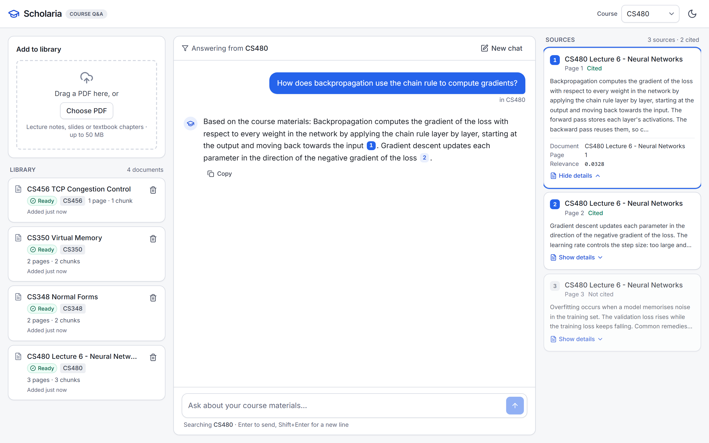
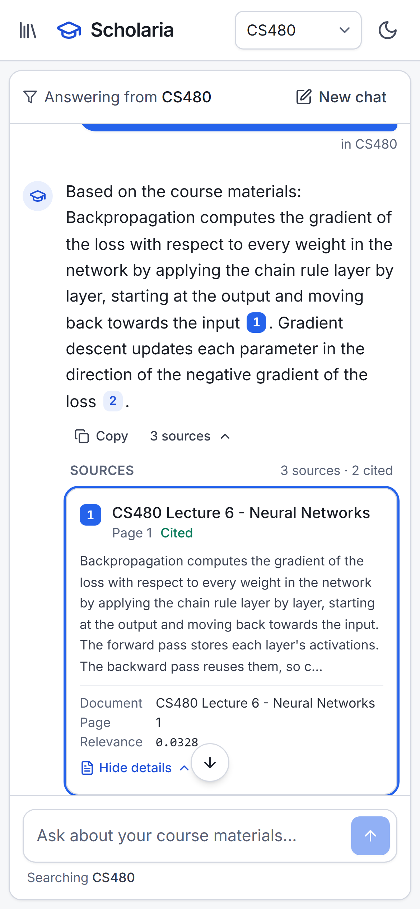
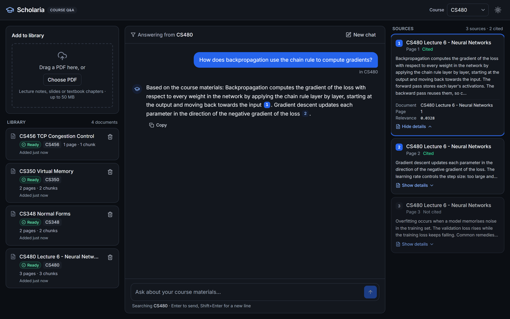
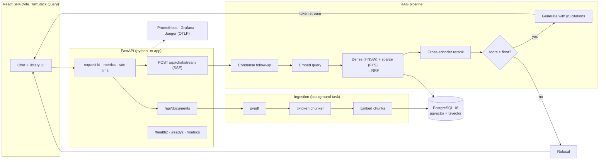

<div align="center">

# Scholaria

**Retrieval-augmented Q&A over your course materials, with cited, streamed answers.**

Upload lecture notes and textbook PDFs, ask questions, and get answers that cite the exact page they came from. Hybrid retrieval with a cross-encoder reranker, a relevance gate that refuses out-of-scope questions, and an evaluation harness that gates CI on measured retrieval quality.

[Results](#measured-results) · [Quick start](#quick-start) · [Architecture](#architecture) · [Evaluation](docs/EVAL.md) · [Operations](#operations) · [Design notes](docs/ARCHITECTURE.md)



</div>

## What it does

- **Cited, streamed answers.** Tokens stream over Server-Sent Events. Every claim carries an `[n]` marker, shown as a clickable chip that scrolls to its source card (document, page, snippet).
- **Hybrid retrieval + reranking.** pgvector (HNSW, cosine) and Postgres full-text search run side by side and are fused with Reciprocal Rank Fusion. A cross-encoder then reranks the fused pool.
- **Knows when not to answer.** When the best reranked passage scores below a tuned floor, the API refuses instead of answering from weak context.
- **Follow-up questions.** Chat history is condensed into a standalone query before retrieval.
- **Course-scoped search.** You can filter by course code. Upload has drag-and-drop, server-side validation, deduplication by content hash and status tracking.
- **Runs for free.** It needs no paid API. Local `all-MiniLM-L6-v2` embeddings and a local cross-encoder handle retrieval, and any OpenAI-compatible endpoint (Groq's free tier, a local Ollama) generates answers. A fully offline profile (deterministic fake LLM, hashing embedder) powers the tests, CI and load tests.
- **Mobile, dark mode, accessibility.** The library opens as a drawer on phones, the page never scrolls horizontally at 375 px, and status updates are announced through `aria-live`.

<p align="center">
  
  &nbsp;&nbsp;
  
</p>

## Measured results

All numbers below come from commands in this repo, run on 2026-11-03 (Ryzen 7 5800X, CPU only). Methodology, per-category breakdowns and limitations are in [docs/EVAL.md](docs/EVAL.md).

**Retrieval ablation.** 55-question golden set over a 4-course, 32-section corpus. The 47 in-scope questions are ranked; the 8 out-of-scope ones are excluded.

| Configuration | hit@1 | recall@5 | MRR@10 | nDCG@10 |
|---|---|---|---|---|
| Dense only (pgvector) | 0.766 | 0.979 | 0.849 | 0.867 |
| Sparse only (Postgres FTS) | 0.723 | 0.957 | 0.836 | 0.865 |
| Hybrid (RRF) | 0.766 | 0.979 | 0.869 | 0.897 |
| **Hybrid + cross-encoder rerank (production)** | **0.915** | **0.979** | **0.950** | **0.962** |

- **The reranker is what pays off.** Dense → production: +0.101 MRR@10 (95% bootstrap CI [+0.024, +0.184]) and +0.149 hit@1 ([+0.021, +0.277]), which is +12% and +20% relative.
- **RRF fusion alone is not a significant gain on this corpus:** +0.020 MRR@10, CI [−0.033, +0.074]. It does help keyword-anchored questions (MRR@10 0.897 vs 0.810 for dense).
- **Relevance gate (`RERANK_MIN_SCORE=-9`):** it refuses 6 of 8 out-of-scope questions with 0 false refusals on the 47 in-scope ones. Without the gate the count was 0 of 8. The floor was tuned on the same set, so treat this as an optimistic, in-sample number.
- **Grounding** (deterministic fake LLM): citation validity 1.000, context recall 0.979.

**Engineering**

| | |
|---|---|
| Backend tests | 220 (unit + Postgres integration), 98% line coverage of `app/` |
| Frontend tests | 60 Vitest unit/component tests and 12 Playwright end-to-end specs (desktop and mobile) |
| Static checks | ruff, `mypy --strict`, eslint with `--max-warnings 0`, `tsc --noEmit` |
| Production image | about 580 MB compressed: API, built SPA and both models baked in. The previous image was 3.1 GB. |
| Load test (k6, offline profile) | 7,996 requests at 48 req/s with 0% errors. Chat full-stream p95 is 13 ms and document list p95 4.4 ms. This measures the platform, not an LLM. |
| Real-model latency | about 1 s per question on CPU, dominated by the cross-encoder reranking ~25 chunks (embed 7 ms, SQL 6 ms) |

## Quick start

Requirements: Docker. For running outside containers: Python 3.12, Node 22.

```bash
git clone https://github.com/<you>/Scholaria && cd Scholaria
make dev          # Postgres + API (hot reload, :8000) + Vite (:5173); runs migrations
make seed         # in another terminal: render and ingest the 4-course demo corpus
```

Open http://localhost:5173 (API docs at http://localhost:8000/docs). `make help` lists every command. Without `make`, use `docker compose up --build`, then `docker compose exec backend python -m scripts.seed_demo_docs`.

### Choosing a profile

Settings are environment variables (see [`.env.example`](.env.example)). Three profiles cover most needs:

| Profile | Embeddings / reranker | LLM | Needs |
|---|---|---|---|
| **Offline** (tests, CI, load tests) | `EMBEDDING_PROVIDER=hash EMBEDDING_DIM=256 RERANKER_PROVIDER=none` | `LLM_PROVIDER=fake` | nothing |
| **Free real** (default for Fly) | `EMBEDDING_PROVIDER=local EMBEDDING_DIM=384 RERANKER_PROVIDER=local RERANK_MIN_SCORE=-9` | Groq or Ollama via `LLM_BASE_URL` | a free Groq key, or Ollama running locally |
| **OpenAI** | `EMBEDDING_PROVIDER=openai EMBEDDING_DIM=1536` | `LLM_PROVIDER=openai` | `OPENAI_API_KEY` |

```bash
# Groq (free tier)
LLM_BASE_URL=https://api.groq.com/openai/v1  LLM_API_KEY=gsk_...  LLM_MODEL=llama-3.1-8b-instant
# Ollama (local, no key)
LLM_BASE_URL=http://host.docker.internal:11434/v1  LLM_MODEL=llama3.1:8b
```

`EMBEDDING_DIM` is fixed into the schema by the first migration. Switching embedders needs a fresh database and a re-ingest.

## Architecture



**SSE contract:** `context` (ranked sources) → `token`… → `citations` (sources actually cited) → `done` (`outcome`: `answered` / `no_context`). Failures arrive as an `error` event with a user-safe message and the request id. Raw exception text never reaches the client.

**Stack:** FastAPI, Pydantic v2, SQLAlchemy 2 (async) + asyncpg, Alembic, pgvector, sentence-transformers, OpenAI SDK (any compatible endpoint), structlog, prometheus-client, OpenTelemetry, slowapi · React 18, TypeScript, Vite, TanStack Query, Tailwind, KaTeX (lazy-loaded) · Docker, GitHub Actions, Fly.io, k6, Playwright.

The design choices and their trade-offs (pgvector over a dedicated vector DB, SSE over WebSockets, why the reranker and not RRF earns its keep) are in [docs/ARCHITECTURE.md](docs/ARCHITECTURE.md).

## Evaluation

```bash
make eval   # seeds a scratch DB, runs the retrieval and generation evals on the free real profile
```

- **Retrieval eval:** compares all four configurations on the same candidate pool. It reports hit@1, recall@5, MRR@10 and nDCG@10 with paired bootstrap confidence intervals, and can sweep `--sweep` knobs (top-k, RRF k, chunk size, AND vs OR full-text matching).
- **Generation eval:** runs every question through the production `RagPipeline.stream()`. It checks citation validity and coverage, context recall, refusal accuracy and the false-refusal rate. An optional LLM-as-judge adds faithfulness and correctness when a real LLM is configured.
- **Gating:** both exit non-zero when the production configuration drops below the versioned thresholds in [`backend/eval/thresholds.json`](backend/eval/thresholds.json), and CI runs both.

## Operations

```bash
make obs        # dev stack + Prometheus :9090, Grafana :3000, Jaeger :16686
make stack      # production image + observability on the offline profile
make loadtest   # k6 against `make stack`
```

- **Metrics:** HTTP rate, errors and latency by route template; per-stage RAG latency (condense, embed, retrieve, rerank, time to first token, total generation); answer outcomes; LLM token counts; ingestion results and duration.
- **Grafana dashboard:** provisioned from [`ops/grafana`](ops/grafana).
- **SLO alerts:** p95 time to first token ≤ 2.5 s, and 99% chat availability with multi-window burn-rate alerts. They are unit-tested with `promtool test rules` ([`ops/prometheus`](ops/prometheus)).
- **Tracing:** OpenTelemetry spans for `rag.condense`, `rag.embed`, `rag.retrieve`, `rag.rerank`, `rag.generate` and `ingest.document`. They are exported only when `OTEL_EXPORTER_OTLP_ENDPOINT` is set.
- **Logs:** structured JSON lines carrying the request id, which is also returned as `x-request-id` and shown in UI error messages.
- **Hardening:**
  - Per-IP rate limits on chat and upload, returning 429 with `retry-after`. They key on a header the edge proxy sets (`Fly-Client-IP`), never on the client-controlled `X-Forwarded-For`.
  - Upload size limit enforced before the body is spooled to disk: a declared `Content-Length` is rejected up front, and chunked bodies are counted while they stream.
  - Models load at startup, so the first question never blocks the event loop.
  - PDF magic-byte check.
  - Idempotent uploads by content hash, with no ingestion race.
  - `/readyz` returns 503 with a bounded timeout when the database is down.
  - The container runs as non-root.

### CI ([`.github/workflows/ci.yml`](.github/workflows/ci.yml))

| Job | What it gates |
|---|---|
| backend | ruff, format, mypy strict, migrations up/down/up, pytest with coverage against pgvector |
| frontend | eslint, tsc, Vitest, production build |
| e2e | Playwright against a real API + Postgres (offline profile) |
| retrieval-eval / generation-eval | eval thresholds on the free real profile |
| docker | build, 14-check smoke test of the image, Trivy scan (report only) |
| ops | actionlint, compose config, promtool config + rule tests, dashboard JSON |

A nightly workflow runs the k6 load test.

## Deployment (Fly.io)

One image serves the API and the built SPA from the same origin. Migrations run as Fly's `release_command`, before any machine is replaced. Both local models are baked into the image, so cold starts never download from Hugging Face.

```bash
fly launch --copy-config --no-deploy
fly secrets set DATABASE_URL=postgresql+asyncpg://... DATABASE_URL_SYNC=postgresql+psycopg://... LLM_API_KEY=...
fly deploy
fly ssh console -C "python -m scripts.seed_demo_docs"   # optional demo corpus
```

The database must have the `vector` extension (Fly Managed Postgres, Supabase or Neon). Prometheus metrics are served on a private port (`METRICS_PORT=9091`) that Fly scrapes over its internal network, and the public `/metrics` returns 404. The VM is sized at 2 GB because the API measured 788 MiB with both models loaded.

## Project layout

```
backend/
  app/
    api/routes/      chat (SSE), documents, health/metrics
    core/            config, logging, metrics, tracing, rate limiting, middleware, SPA serving
    db/              SQLAlchemy models, async session
    rag/             chunker, embeddings, retriever (dense+sparse+RRF), reranker, generator, pipeline
    services/        ingestion (register upload → parse → chunk → embed)
  alembic/           migrations
  eval/              retrieval + generation evals, golden dataset, thresholds
  scripts/           demo corpus (Markdown → deterministic PDFs) and seeding
  tests/             unit tests + tests/integration (real Postgres)
frontend/
  src/               components, hooks (useChat SSE, useDocuments), lib (api, sse, citations)
  e2e/               Playwright specs (desktop + mobile)
ops/                 Prometheus rules + tests, Grafana dashboards, Jaeger, image smoke test
loadtest/k6/         smoke and load scenarios
docs/                ARCHITECTURE.md, EVAL.md, screenshots
Dockerfile           single production image (API + SPA + models)
docker-compose*.yml  dev, prod and observability overlays
Makefile             every command above
```

## Limitations

- **Small evaluation corpus** (32 sections). Recall@5 is near its ceiling, and differences under about 0.08 MRR@10 are within noise. The questions and labels were written by the corpus author.
- **The LLM judge has not been run.** Answer quality from a real LLM is not yet measured, and grounding numbers come from the deterministic fake LLM.
- **No auth or multi-tenancy.** Documents are shared by everyone using the instance.
- **Ingestion runs in-process** (FastAPI background tasks). A restart mid-ingest leaves a document stale until it is re-uploaded. A durable queue (Arq or Celery) is the next step.
- **Rate-limit counters are per process** unless `RATE_LIMIT_STORAGE_URI` points at Redis.

## License

MIT.
